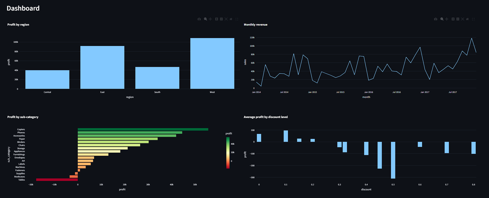
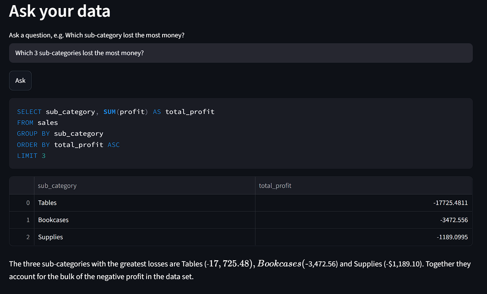
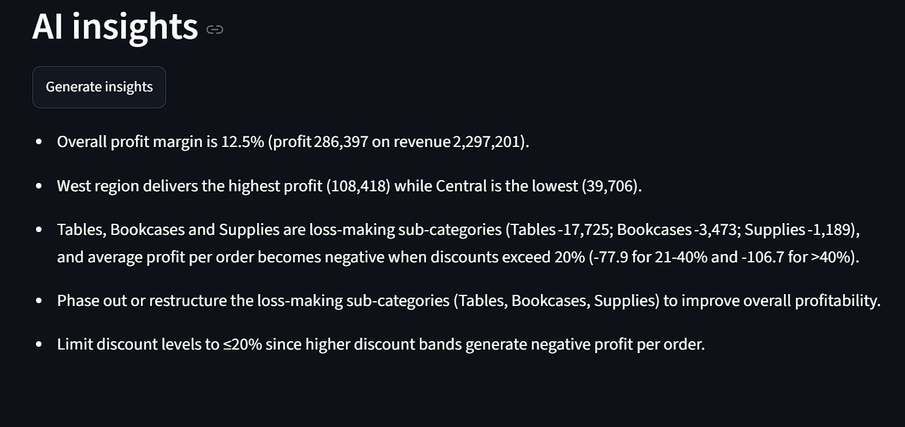

# AI-Powered Sales Analytics Assistant

An interactive sales dashboard where you can **ask questions about the data in plain English**. An LLM converts each question into SQL, a safety layer checks it, the query runs on a read-only database, and the answer is explained in simple language. The app can also generate a short set of findings and recommendations from the data.

**Live demo:** [Open AI Sales Analytics Assistant](https://ai-sales-assistant-8a6pv5temh4zqecmocdl27.streamlit.app/)



---

## What it does

- **Interactive dashboard** with region and category filters, KPIs (revenue, profit, margin, orders) and four charts.
- **Ask your data:** type a question such as "Which sub-category lost the most money?" and get the SQL, a result table and a short explanation.
- **AI insights:** one click produces 3 key findings and 2 recommendations, written from numbers computed in pandas.
- **Safe by design:** the AI can only run read-only `SELECT` queries.





---

## Key findings from the data

The dataset has 9,994 order lines and 5,009 orders: about $2.30M revenue, $286K profit and a 12.5% profit margin.

| Finding | Evidence |
|---|---|
| Profit is uneven across regions | West earns about $108K, while Central earns about $40K |
| Discounts above 30% make orders loss-making | Average profit per order is positive up to a 20% discount, and negative from 30% upward (about -$311 at 50%) |
| Tables are the biggest loser | About -$17.7K total profit; +$13.3K at 0% discount, but losses from 20% upward |
| Furniture has a thin margin | About 2.5%, against about 17% for Office Supplies and Technology |
| Supplies lose money without heavy discounting | Average discount is only 8%, so another cause (such as costs) needs further analysis |

---

## How it works

```
User question
     |
     v
LLM writes a SQLite SELECT query (schema is given in the prompt)
     |
     v
Safety check: SELECT only, one statement, no write/DDL keywords
     |
     v
Query runs on a read-only database connection
     |
     v
Result table + plain-English explanation from the LLM
```

**Two layers of protection:**
1. `is_safe()` rejects anything that is not a single `SELECT` statement or that contains keywords such as `DROP`, `DELETE`, `UPDATE`, `INSERT`, `ALTER`, `ATTACH` or `PRAGMA`.
2. The database is opened in read-only mode (`mode=ro`), so even a missed check cannot change the data.

The insight generator never sees the raw table. It receives a short summary of figures computed in pandas, and the prompt tells it to use only those numbers.

---

## Tech stack

- **Python**, **pandas**: data cleaning and analysis
- **SQLite**: database and SQL queries
- **Streamlit** and **Plotly**: dashboard and charts
- **Groq API** with an open-weight LLM: natural-language to SQL and explanations

---

## Project structure

```
ai-sales-assistant/
├── app.py            # Streamlit dashboard and AI features
├── ai_sql.py         # LLM calls, SQL safety check, read-only query runner
├── load_data.py      # Cleans the CSV and builds sales.db
├── practice.py       # Example SQL analysis queries
├── sales.db          # SQLite database (generated from the dataset)
├── requirements.txt
├── screenshots/
└── README.md
```

---

## Run it locally

**1. Clone the repository**
```bash
git clone https://github.com/chirag11365/ai-sales-assistant.git
cd ai-sales-assistant
```

**2. Install the requirements**
```bash
python -m pip install -r requirements.txt
```

**3. Add your Groq API key**

Create a free key at [console.groq.com](https://console.groq.com), then create a file named `.env` in the project folder:
```
GROQ_API_KEY=your_key_here
```

**4. (Optional) Rebuild the database from the raw CSV**

Download the Superstore dataset from Kaggle, save it as `superstore.csv` in the project folder and run:
```bash
python load_data.py
```
A ready-made `sales.db` is already included, so you can skip this step.

**5. Start the app**
```bash
python -m streamlit run app.py
```
Open the local link shown in the terminal.

> **Model note:** the model name is set in `ai_sql.py` (`MODEL = ...`). Groq changes its model list often. If you see a "model not found" error, list the models available to your key and update that line.

---

## Example questions to try

- Which region has the lowest profit?
- Which 3 sub-categories lost the most money?
- What is the average profit at a 50% discount?
- Which category has the lowest profit margin?
- Show monthly sales for 2017.

Always check the SQL shown above each result. The model can misread a question, and the visible SQL lets you verify the answer.

---

## Limitations

- The model can write incorrect SQL for unusual or ambiguous questions, so answers should be checked against the shown query.
- The app is built for one table (`sales`). Adding more tables would need an updated schema prompt.
- The explanations are generated by an LLM and are only as reliable as the numbers it is given.

## Future improvements

- Retry automatically when a generated query fails
- Add a sales forecast for the next months
- Support uploading your own CSV
- Add automated tests for the safety checks

---

## Dataset

Sample Superstore dataset from Kaggle (about 9,994 rows covering orders, sales, discounts and profit in the US, 2014 to 2017). Check the license on its Kaggle page and credit the original author.

## Author

**Chirag Verma**: B.Tech ECE, BIT Mesra (Patna)
[GitHub](https://github.com/chirag11365) | chirag11365@gmail.com
